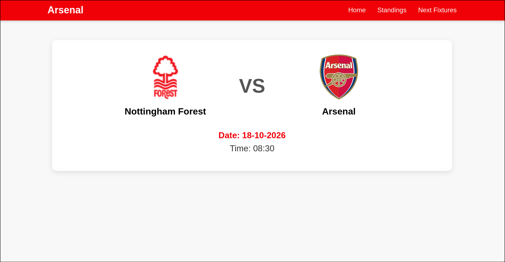
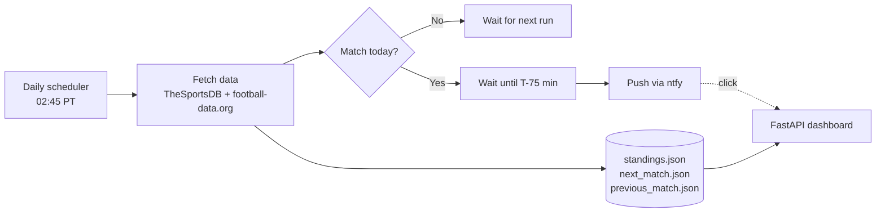

# ArsenalRemind

> A self-hosted service that pings my phone an hour before Arsenal kick off, with a small dashboard showing the next match, previous match, upcoming fixtures, and league tables.




## Why I built this

I kept missing kick-offs because Arsenal matches land at odd hours in Pacific time and fixtures span several competitions. Calendar apps don't handle rescheduled games well, so I built something that checks live fixture data every day and only bothers me when it matters.

## Features

- **Daily fixture check** against live football APIs, across the Premier League and Champions League
- **Timezone-aware scheduling**: converts UTC kick-off times to US Pacific and sleeps until 75 minutes before the match
- **Push notifications** via [ntfy](https://ntfy.sh) with a click-through link to the dashboard
- **Dashboard** with the next match (with club crests), the previous match, the upcoming fixture list, and league standings
- **Self-hosted over Tailscale**, so the dashboard stays private

## How it works



1. `reminder.py` runs once a day and uses `arsenal.py` to pull Arsenal's match data and the league table from two APIs.
2. It sorts the fixtures by date and picks the next match and the previous result.
3. If the match is today, it sleeps until 75 minutes before kick-off, then sends a push notification.
4. Standings, the next match, and the previous match are each saved to their own JSON file, which the dashboard (`app.py`) reads.

## Tech stack

| Area | Tools |
|---|---|
| Language | Python 3.12+ |
| Packaging | [uv](https://docs.astral.sh/uv/) |
| Web | [FastAPI](https://fastapi.tiangolo.com) + Jinja2 templates |
| Scheduling | [`schedule`](https://schedule.readthedocs.io/) |
| Notifications | [ntfy](https://ntfy.sh) |
| Data sources | [TheSportsDB](https://www.thesportsdb.com), [football-data.org](https://www.football-data.org) |
| Networking | [Tailscale](https://tailscale.com) |

## Getting started

### Prerequisites

- Python 3.12+ and [uv](https://docs.astral.sh/uv/getting-started/installation/)
- A free API key from [football-data.org](https://www.football-data.org/client/register)
- The [ntfy app](https://ntfy.sh) on your phone, subscribed to the topic used in `send_message()` in `arsenal.py`

### Install

```bash
git clone https://github.com/justincox8/ArsenalRemind.git
cd ArsenalRemind
uv sync
cp .env.example .env   # then fill in your key
```

### Configure

| Variable | Description |
|---|---|
| `API_FOOTBALL_KEY` | football-data.org token (standings) |

### Run

Run both from the project folder, since they share the JSON data files.

```bash
# Reminder scheduler
uv run python reminder.py

# Dashboard at http://localhost:8000
uv run uvicorn app:app --host 0.0.0.0 --port 8000
```

## Project structure

```
ArsenalRemind/
├── app.py           # FastAPI dashboard routes
├── arsenal.py       # API calls, next-match logic, ntfy notification
├── reminder.py      # daily scheduler
├── templates/       # HTML pages (home, fixtures, standings)
├── static/css/      # styles
├── screenshots/     # images used in this README
├── .env.example     # which environment variables you need
├── pyproject.toml   # dependencies
└── uv.lock
```

The JSON data files (`standings.json`, `next_match.json`, `previous_match.json`) are generated at runtime and kept out of git.

## Design notes

- **Two data sources.** TheSportsDB supplies the bulk of the match data, and football-data.org supplies the league standings.
- **One file per view.** Standings, the next match, and the previous match each live in their own JSON file, so each page only reads what it needs.
- **Fuzzy crest matching.** Fixture and standings APIs spell club names differently ("Arsenal" vs "Arsenal FC"), so the dashboard matches names with `fuzzywuzzy` to find the right crest.
- **Timezones.** Providers return UTC and everything is converted to `America/Los_Angeles` with `zoneinfo`.
- **Secrets stay out of git.** The key is loaded from the environment with `python-dotenv`.

## Roadmap

- [ ] FA Cup and EFL Cup fixtures
- [ ] Unit tests for fixture merging and timezone conversion
- [ ] Retry and backoff on API failures
- [ ] Dockerfile for one-command deployment

## License

MIT, see [LICENSE](LICENSE).

---

Built by [Justin Cox](https://github.com/justincox8)
