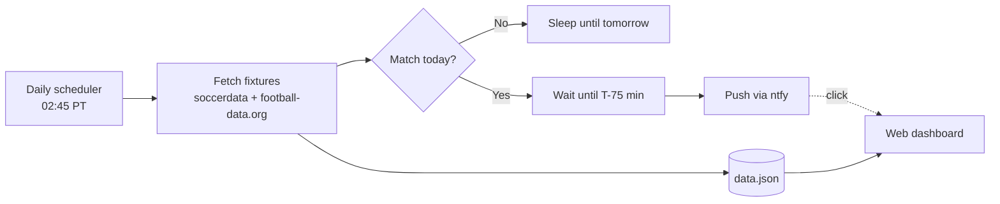

# ArsenalRemind

> A self-hosted service that pings my phone an hour before Arsenal kick off, with a small dashboard showing the next match, upcoming fixtures, and league tables.


<!-- Add a screenshot of the dashboard and a screenshot of the phone notification:

-->

## Why I built this

I kept missing kick-offs because Arsenal matches land at odd hours in Pacific time and fixtures span three competitions. Calendar apps don't handle rescheduled games well, so I built something that checks live fixture data every day and only bothers me when it matters.

## Features

- **Daily fixture check** against live football APIs, across the Premier League and Champions League
- **Timezone-aware scheduling**: converts UTC kick-off times to US Pacific and sleeps until 75 minutes before the match
- **Push notifications** via [ntfy](https://ntfy.sh) with a click-through link to the dashboard
- **Dashboard** with the next match, the fixture list, and Premier League and Champions League standings
- **Self-hosted over Tailscale**, so the dashboard is private without public exposure

## How it works



1. A scheduler runs once a day and pulls Arsenal's fixtures from two APIs.
2. It merges Premier League and Champions League matches, sorts them by date, and picks the next one.
3. If the match is today, it sleeps until 75 minutes before kick-off, then sends the notification.
4. The results, including fixture list and standings, are written to `data.json`, which the dashboard reads.

## Tech stack

| Area | Tools |
|---|---|
| Language | Python 3.12+ |
| Packaging | [uv](https://docs.astral.sh/uv/) |
| Web | Flask-style app with Jinja templates (`templates/`, `static/css/`) |
| Scheduling | [`schedule`](https://schedule.readthedocs.io/) |
| Notifications | [ntfy](https://ntfy.sh) |
| Data sources | [SoccerDataAPI](https://soccerdataapi.com), [football-data.org](https://www.football-data.org) |
| Networking | [Tailscale](https://tailscale.com) |

## Getting started

### Prerequisites

- Python 3.12+
- [uv](https://docs.astral.sh/uv/getting-started/installation/)
- Free API keys from [SoccerDataAPI](https://soccerdataapi.com) and [football-data.org](https://www.football-data.org/client/register)
- The [ntfy app](https://ntfy.sh) on your phone, subscribed to your own topic

### Install

```bash
git clone https://github.com/justincox8/ArsenalRemind.git
cd ArsenalRemind
uv sync
cp .env.example .env   # then fill in your keys
```

### Configure

| Variable | Description |
|---|---|
| `SOCCERDATA_API_KEY` | SoccerDataAPI auth token (Premier League fixtures) |
| `FOOTBALL_DATA_API_KEY` | football-data.org token (Champions League and standings) |
| `NTFY_TOPIC` | Your private ntfy topic name |
| `DASHBOARD_URL` | URL opened when you tap the notification |

### Run

```bash
# Start the reminder scheduler
uv run python -m arsenal_remind.scheduler

# Start the dashboard
uv run python -m arsenal_remind.web.app
```

## Project structure

```
ArsenalRemind/
├── src/arsenal_remind/
│   ├── config.py        # env vars and constants
│   ├── clients.py       # API calls (fixtures, standings)
│   ├── fixtures.py      # merge, sort, and pick the next match
│   ├── notify.py        # ntfy integration
│   ├── scheduler.py     # daily job and wait-until-kickoff logic
│   └── web/
│       ├── app.py
│       ├── templates/
│       └── static/css/
├── tests/
├── docs/
├── .env.example
├── pyproject.toml
└── uv.lock
```

## Design notes

- **Two data sources.** No single free API covered every competition and standings, so fixtures from both are normalized into one shape before sorting.
- **Timezones.** Providers return UTC. Everything is converted to `America/Los_Angeles` with `zoneinfo`, so it is DST-safe.
- **Secrets stay out of git.** Keys are loaded from the environment with `python-dotenv`.

## Roadmap

- [ ] FA Cup and EFL Cup fixtures
- [ ] Unit tests for fixture merging and timezone conversion
- [ ] Retry and backoff on API failures
- [ ] Dockerfile for one-command deployment
- [ ] GitHub Actions CI (lint and tests)

## License

MIT, see [LICENSE](LICENSE).

---

Built by [Justin Cox](https://github.com/justincox8)